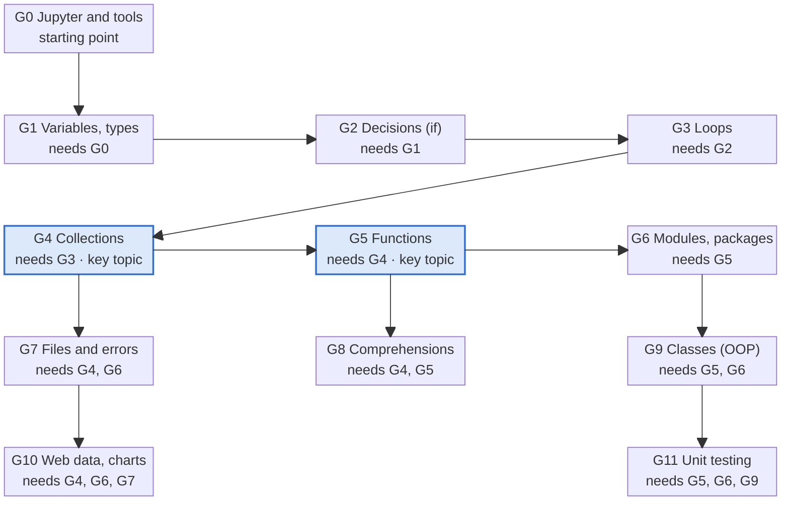

# Python Course – Learning Goals Map (Addendum for Non-Programmers)

Oct 15, 2026 · @Michael

## Purpose and how to read this

The course expects 12 groups of skills, from running a notebook up to writing classes, calling web APIs and unit-testing code. They build strictly on each other: almost every later notebook silently assumes variables, loops, collections and functions.

This addendum is for readers with a strong background in economics, marketing and technical presales for chemical-engineering processes, but no programming experience. It lists what the course expects you to understand, in the order you need to learn it.

- **Groups G0–G11** are sorted by dependency level: a group only needs the groups listed under *Requires*.
- **Core** = practised in the course exercises. **Demo** = shown in the course, but recognising and adapting it is enough.
- **Hidden prerequisites** = things the notebooks use without ever explaining them. These are the most common stumbling blocks for newcomers.

## Course overview

The course has 5 blocks with 17 notebooks plus example `.py` projects. Self-study parts carry core content (collections, files, comprehensions) that later blocks rely on.

| Block | Content | Groups |
| --- | --- | --- |
| 01 Intro | Jupyter; operators, variables, data types; Boolean logic; loops | G0–G3 |
| 01 Self-study | Lists and tuples; dictionaries and sets | G4 |
| 02 Fundamentals | Functions; modules and packages (file-handling preview is an empty placeholder) | G5, G6 |
| 02 Self-study | Directories; file handling and CSV; list comprehension | G7, G8 |
| 03 Classes | Classes notebook, Droids exercise, `02_vector_operations.py` | G9 |
| 03 Requests | Jokes API, weather API, GeoSphere (ZAMG) CSV with pandas, Neusiedler See water level | G10 |
| 04 Own modules | `customModules` (own module + `main`), `qrproject` with `requirements.txt` | G6 |
| 05 Unittests | Unittest notebook, `square_project` with `tests/` folder | G11 |

**Collections and functions unlock everything after the basics**

Arrows show the main learning path; each box lists all its prerequisites. Highlighted: the bottleneck topics.

G4 Collections and G5 Functions are the bottleneck: from Level 3 on, every group requires at least one of them.

## Learning goals by group

Each group lists what you should be able to do afterwards. Source paths are relative to the course folder.

### Level 0 – Working environment

**G0 Tools and running code** · Core · Requires: nothing · *Block\_01\_Intro/00, Block\_04, Block\_05*

- Run and edit cells in a Jupyter notebook; interrupt a stuck cell.
- Write comments with `#` and multi-line strings `"""`.
- Open a terminal in a folder and run a script with `python file.py`.
- Tell a notebook (`.ipynb`) from a script (`.py`) and know when each is used.

### Level 1 – Language basics

**G1 Variables, data types, operators** · Core · Requires: G0 · *Block\_01\_Intro/01*

- Assign values with `=` (right side is stored into left side); reassign and use `+=`.
- Know that `b = a` copies the current value of a number, not a link.
- Use the arithmetic operators `+ - * / // % **` and explain `/` vs `//`.
- Name the basic types `int`, `float`, `str`, `bool` and check them with `type()`.
- Convert between types with `int()`, `float()`, `str()`; know why `input()` always returns text.
- Explain floating-point inaccuracy (`1.2 - 1.0`) and use `round()`.
- Combine text: concatenation with `+`, commas in `print()`, `str.format()`.
- Follow naming rules for variables.

**G2 Decisions (Boolean logic)** · Core · Requires: G1 · *Block\_01\_Intro/02*

- Use `True`/`False` and the comparison operators `== != > < >= <=`.
- Write `if`, `elif`, `else` blocks; understand that indentation defines the block.
- Explain why separate `if`s differ from an `if/elif` chain.
- Nest conditions and combine them with `and`, `or`, `not`; read a truth table.

**G3 Loops** · Core · Requires: G2 · *Block\_01\_Intro/03*

- Use `while` when the number of repetitions is unknown (e.g. user input).
- Use `for` with `range(start, stop, step)`; know that `stop` is excluded.
- Control loops with `break` and `continue`; avoid or deliberately end infinite loops.
- Read nested loops (rows × columns, like a spreadsheet).

### Level 2 – Organising data and code

**G4 Collections** · Core · Requires: G3 · *Block\_01\_SelfStudy/Collections*

- Lists: create, index from 0, negative index, slice `[start:end]`, `append`, `insert`, `extend`, `remove`, `del`.
- Loop over a list with `for item in list`; use `len`, `sum`, `min`, `max`, `sorted`, `in`.
- Tuples: ordered but unchangeable; the one-element tuple `("x",)`; named tuples via `collections`.
- Dictionaries: key–value access, add/update/delete keys, loop with `.keys()`, `.values()`, `.items()`; nested data; `pprint`.
- Sets: unique elements, `add`, `remove` vs `discard`, union, intersection, difference.
- Choose the right collection (ordered? changeable? duplicates?).
- Copy by reference vs shallow copy vs `deepcopy`.

**G5 Functions** · Core · Requires: G4 · *Block\_02\_Fundamentals/01*

- Define with `def` and call a function; follow the order of execution.
- Distinguish parameters (in the definition) from arguments (in the call).
- Return values with `return`; know that no `return` means `None`.
- Use multiple and default parameters.
- Explain local vs global scope and why returning a value beats `global`.
- Recognise `*args` and `**kwargs`.

**G6 Modules and packages** · Core · Requires: G5 · *Block\_02\_Fundamentals/02, Block\_04\_OwnModules*

- Explain statement, script, module, package, library.
- Import with `import x`, `import x as y`, `from x import name`, `from x import *`.
- Use standard modules: `math`, `random`, `time`, `datetime`, `string`.
- Install packages with `pip` / `%pip` / `conda`; find them on PyPI; read a `requirements.txt`.
- Write your own module (`functions.py`) with functions, constants and classes, and import it.
- Use the `if __name__ == "__main__":` guard and a `main()` function.

### Level 3 – Working with real data

**G7 Files, folders and errors** · Core · Requires: G4, G6 · *Block\_02\_SefStudy/FileHandling*

- Use `os` for folders: `getcwd`, `listdir`, `mkdir`, `rmdir`, `remove`, `path.exists`, `isdir`, `isfile`.
- Prefer relative over absolute paths.
- Open files with modes `r`, `w`, `a`, `x`; read with `read()`, `readline()`, `readlines()`, or line by line.
- Write with `write()` / `writelines()`; use `"\n".join(list)`.
- Use the `with open(...)` context manager instead of manual `close()`.
- Read and write CSV with `csv.reader` / `csv.writer`, a delimiter and `newline=''`.
- Handle errors with `try / except / else / finally`; catch specific errors such as `FileNotFoundError`.
- Explain ASCII vs UTF-8 and pass `encoding='utf-8'`.

**G8 Comprehensions** · Core · Requires: G4, G5 · *Block\_02\_SefStudy/ListComprehension*

- Rewrite a `for` + `append` loop as `[expr for x in items]`.
- Filter with `if`, transform with `a if cond else b`.
- Read nested comprehensions (flattening, combinations) and translate them back into loops.
- Use `enumerate()`, dictionary comprehensions and set comprehensions.

### Level 4 – Advanced topics

**G9 Classes and objects** · Core · Requires: G5, G6 · *Block\_03\_Classes\_Requests/Classes*

- Explain class, object (instance), attribute, method.
- Write `__init__` and use `self`; add `__str__` for readable output.
- Write your own methods that change an object's state.
- Use `@classmethod` as an alternative constructor and `@staticmethod` as a helper.
- Overload operators with magic methods (`__add__`, `__sub__`, `__mul__`), e.g. for force vectors.
- Distinguish class attributes (shared) from instance attributes.
- Apply encapsulation: `_protected`, `__private`, getter methods.
- Use `@property` and a setter that validates input with `raise ValueError`.

**G10 Web data and analysis** · Core · Requires: G4, G6, G7 · *Block\_03\_Classes\_Requests/Requests*

- Fetch a URL with `requests.get()` (and recognise `urllib`, `urllib3`).
- Turn a JSON response into dicts and lists with `.json()`; pick values out of nested JSON.
- Send headers and query parameters; understand API keys and request limits.
- Load a CSV into a pandas `DataFrame` with `delimiter` and `decimal`; select columns, rows (`loc`), filter and sort.
- Draw bar and line charts with `matplotlib`, including titles, axis labels and date axes.
- Parse text data with fixed positions, `datetime.strptime` and decimal-comma replacement.

**Foundation for the follow-up data-analytics course.** The notebooks only touch pandas briefly, so practise these beyond them until they feel routine:

- Inspect a `DataFrame` with `head()`, `info()`, `describe()` and `dtypes`.
- Clean data: rename columns, convert types and dates with `pd.to_datetime`, handle missing values with `isna`, `dropna`, `fillna`.
- Derive new columns from existing ones (e.g. unit conversions, margins).
- Group and aggregate with `groupby` and `pivot_table` – the pandas version of an Excel pivot table.
- Combine tables with `merge` and `concat`.
- Save results with `to_csv` / `to_excel` and plot directly from a `DataFrame`.

**G11 Unit testing** · Core · Requires: G5, G6, G9 · *Block\_05\_Unittests*

- Explain why tests make code safer to change.
- Write a test class inheriting from `unittest.TestCase`, with methods starting with `test_`.
- Use `assertEqual`, `assertTrue`, `assertFalse`, `assertIn`, `assertAlmostEqual`, `assertRaises`.
- Test normal values, edge cases (empty list, zero) and expected errors.
- Separate code and tests into files and a `tests/` folder; run `python -m unittest discover -s tests -v`.

### Hidden prerequisites

The notebooks use these without introducing them. Learn them early, alongside G1–G5.

| Topic | First used in | Needed for |
| --- | --- | --- |
| f-strings `f"{name}"` | Modules (guessing game), Classes | G6, G9, G11 |
| String methods `.strip()`, `.lower()`, `.replace()`, `.join()`, `.splitlines()` | File Handling, Requests, Unittests | G7, G10, G11 |
| String slicing `line[0:2]`, `text[::-1]` | File Handling, Unittests | G7, G11 |
| `raise` to signal an error | Classes (`@property`), Unittests | G9, G11 |
| Inheritance (`class Test(unittest.TestCase)`) | Unittests | G11 |
| Decorators `@...` as syntax | Classes | G9 |
| `any()` with a generator expression | Unittests (password check) | G11 |
| Terminal basics: `cd`, current folder | Classes (.py), Unittests | G6, G11 |

## Suggested study path and bridges to your field

Follow the levels in order and do not skip G4 and G5: every later block depends on them. Build each habit with small examples from your own work.

1. **G0–G3 together.** Use a process or sales calculation, e.g. a mass balance or a discount scheme, as the running example.
2. **G4 Collections.** This is the biggest jump. Think of a list as one spreadsheet column, a dictionary as a lookup table (`VLOOKUP`), and a list of dictionaries as a table of rows.
3. **G5 Functions**, plus the hidden prerequisites f-strings and string methods.
4. **G6, then G7 and G8.** After G7 you can read and write the CSV exports you already use in Excel.
5. **G9 Classes.** Treat a class like a datasheet template: a `Pump` or `Reactor` class with attributes such as flow rate, and methods such as `pressure_drop()`.
6. **G10 and G11.** G10 is where Python beats spreadsheets: fetching live data, cleaning and analysing it with pandas, and plotting it. Give it the most practice time, since the data-analytics follow-up builds on it. G11 is like checking a calculation sheet against known reference values.

| Course concept | Familiar equivalent |
| --- | --- |
| Variable | Named cell |
| `if / elif / else` | `IF()` / nested `IF()` in Excel |
| `for` loop over a list | Filling a formula down a column |
| Dictionary | Lookup table, product catalogue by article number |
| Function | Reusable formula or calculation sheet with inputs and one result |
| Module / package | Add-in or template library |
| CSV + `csv` / pandas | Excel import/export, pivot-ready data |
| Class with `@property` | Equipment datasheet with derived values (e.g. °C to °F) |
| `try / except` | `IFERROR()` |
| Web API + JSON | Live price, weather or process-historian feed |
| Unit test | Validating a calculation against a known reference case |

## Key requirements for the addition course

The addition course is a minimal bridge: it fills the gaps this map exposes and makes pandas data processing fluent, as the base for a later data-analytics course. How lessons are built follows the separate course design guideline.

| ID | Requirement | Reason |
| --- | --- | --- |
| R1 | Audience: adult technicians, presales and business staff with no programming background | Readers of this addendum |
| R2 | Minimal scope: only what the existing course lacks or rushes; no repeat of G0–G3 beyond a refresher | Keeps the course short; G0–G3 are covered in Block 01 |
| R3 | Strengthen the bottleneck groups G4 Collections and G5 Functions with extra practice | Every group from Level 3 on requires one of them |
| R4 | Teach all hidden prerequisites explicitly: f-strings, string methods, slicing, `raise`, inheritance, decorators, `any()`, terminal basics | The notebooks use them without explanation |
| R5 | Fill the empty file-handling preview in Block 02 Fundamentals with a real unit (paths, `with open`, CSV, encodings, `try/except`) | Placeholder notebook today; G7 is a prerequisite for G10 |
| R6 | Make pandas data processing a core track: load, inspect, clean, transform, group/pivot, merge, export, plot | Key requirement for the follow-up data-analytics course; G10 is now Core |
| R7 | Handle real-world data formats: `;` delimiters, decimal commas, local date formats, missing values | Learners' own Excel/CSV exports look like this |
| R8 | Use domain examples: process data, equipment specs, sales and quote data | Adult learners need immediate work relevance |
| R9 | Format: Jupyter notebooks, one per unit, plus a small `.py` project for modules and tests | Matches the existing course structure (Blocks 01–05) |
| R10 | Each unit maps to goal IDs in this map (G0–G11) and states checkable learning goals | Traceability for generating and reviewing content |
| R11 | Final task: an end-to-end analysis on an unseen dataset, from CSV to chart and short conclusion | Proves readiness for the data-analytics course |
| R12 | Time budget: at most 8 h of raw work for the whole addition course, excluding side research and additional reading | Fixed budget set by the course owner; enforces the minimal scope of R2 |
| R13 | Classes (G9) and unit testing (G11) stay in scope | The final exam and project of the course cover both topics |

## Unit plan (8 h budget)

The addition course fits the 8 h budget (R12) in 5 blocks. Each block is split into units of 45–90 minutes, as set by the course design guideline.

| Block | Goal groups | Content | Requirements | Time |
| --- | --- | --- | --- | --- |
| 1 | G4, G5 | Collections and functions practice; hidden prerequisites f-strings, string methods, slicing, terminal basics | R3, R4 | 2.0 h |
| 2 | G7 | Paths, `with open`, CSV, encodings, `try/except`; fills the empty file-handling preview in Block 02 | R5, R7 | 1.0 h |
| 3 | G10 | pandas: load, inspect, clean, transform, group/pivot, merge, export, plot | R6, R7 | 2.5 h |
| 4 | G9, G11 | Classes and unit testing; hidden prerequisites `raise`, inheritance, decorators, `any()` | R4, R13 | 1.5 h |
| 5 | G0–G11 | Final end-to-end task on an unseen dataset | R11 | 1.0 h |
| **Total** | | | | **8.0 h** |
