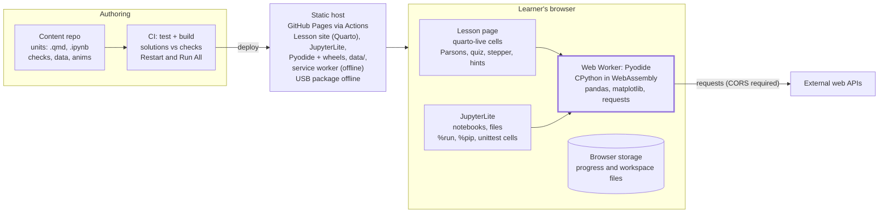
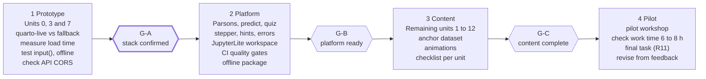

# Browser Python Course — Platform Specification

Oct 15, 2026 · @Michael · Exported from the [shared spec doc](https://claude.ai/code/artifact/ead35c7f-5427-4870-87cf-d22ff0bd1360). Paths are relative to `course_platform/`.

## Purpose and scope

We will build a static website that teaches the Python addition course entirely in the browser: Python runs locally via WebAssembly (Pyodide), so learners install nothing. This spec merges three inputs into one buildable set of requirements: the tool research (this document), the Course Design Guideline (how to teach) and the Learning Goals Map (what to teach), both in `../Addendum/`. Requirement IDs R1–R11, principles P1–P10 and goal groups G0–G11 refer to those two addenda.

- **Audience (R1):** adults in technical presales, process engineering, economics and marketing. Strong domain and spreadsheet skills, no programming experience.
- **Goal:** close the gaps in the existing course (G4 collections, G5 functions, hidden prerequisites, files) and make pandas data processing fluent for the follow-up data-analytics course (R2–R6).
- **Time budget:** 6–8 hours of learner work time in total, final task included.
- **Scope:** G0–G11, with classes (G9) and unit testing (G11) mandatory.
- **Language:** English.
- **Hosting:** GitHub Pages, built by GitHub Actions.
- **Original content only:** all lessons, notebooks and datasets are written new. The existing Block 01–05 notebooks are not copied or adapted; they are used only as a topic checklist through the Learning Goals Map.
- **Platform goal:** open a link, start learning. No installation, no account, no server-side code execution.
- **In scope:** lesson pages with animated explanations, live code cells, the eight-step session pattern, automatic exercise checking, a notebook-style workspace, an offline package for workshops.
- **Non-goals:** user accounts, grading databases, an LMS, a multi-language UI.

## Course content

The platform ships 13 units (0–12) in dependency order, totalling 7 h 20 min of learner work time. That fits the 6–8 h budget with 40 min of buffer. Each unit names its goal IDs (R10). G0–G3 get only a 25-minute refresher (R2); G4 and G5 get the longest units (R3).

| # | Unit | Min | Goal IDs | Covers | Requirement |
| --- | --- | --- | --- | --- | --- |
| 0 | Refresher and platform tour | 25 | G0–G3 | Run and stop cells, variables as name tags, `if`, loops | R2, P9 |
| 1 | Collections: a list is a column, a dict is a lookup table | 45 | G4 | Index, slice, `append`, loops, `len/sum/sorted`, `.items()`, list of dicts as a table, reference vs copy | R3, P9 |
| 2 | Text: f-strings, string methods, slicing | 25 | G1, hidden prerequisites | `f"{x:.2f}"`, `.strip() .lower() .replace() .join()`, `text[::-1]` | R4 |
| 3 | Functions: a reusable formula | 45 | G5, hidden prerequisites | `def`, parameters vs arguments, `return`/`None`, defaults, scope, `raise ValueError`, `*args` (recognise) | R3, R4 |
| 4 | Files, CSV, encodings and errors | 35 | G7 | `with open`, `csv` on `quotes.csv`, `encoding="cp1252"` on `customers.csv`, `try/except` | R5, R7 |
| 5 | Comprehensions, `enumerate`, `any()` | 20 | G8, hidden prerequisites | Loop to comprehension and back, filters, dict comprehensions | R4 |
| 6 | Modules, packages and the terminal | 20 | G6, hidden prerequisites | `import`, own module, `__main__` guard, `%pip` vs `pip`, `cd` (demo) | R4, R9 |
| 7 | pandas: load, inspect, clean | 45 | G10 | `read_csv(sep=";", decimal=",")`, `head/info/describe`, fix status spellings, `to_datetime`, duplicates, `isna/fillna` | R6, R7 |
| 8 | pandas: derive, group, pivot, merge, export, plot | 45 | G10 | Quote value column, `groupby`, `pivot_table`, `merge` with products and customers, `to_csv`, charts | R6 |
| 9 | Web data: `requests` and JSON | 20 | G10 | `requests.get`, `.json()`, nested JSON, snapshot fallback | R6 |
| 10 | Classes: an equipment datasheet | 40 | G9, hidden prerequisites | `Pump` from `products.csv`, `__init__`, `__str__`, `@property` with `raise`, `@classmethod` from a row, inheritance, `__add__` (recognise) | R4 |
| 11 | Unit testing | 35 | G11, hidden prerequisites | `unittest.TestCase`, `assertAlmostEqual`, `assertRaises`, `tests/` folder; tests for unit 3 and 10 code | R9 |
| 12 | Final task on unseen data | 40 | all | `pump_station_readings.csv`: clean, compute kWh/m³ per pump, chart, written conclusion | R11 |

Every unit uses domain examples (R8) and the Excel bridge table from the Learning Goals Map: variable = named cell, dict = `VLOOKUP` table, `try/except` = `IFERROR()`, `pivot_table` = pivot table.

Per-unit deliverables, all checked into the content repository:

- Learning goals as checkable verbs with goal IDs.
- Retrieval warm-up of 3–5 questions on earlier units (P7, P8).
- One animated explanation of the unit's core concept or misconception.
- A worked example with named subgoals (P2).
- One exercise of each kind: predict, Parsons, modify, make, start-from-an-error (P3–P5).
- An exit question that targets a named misconception (P9).

The budget shortens units from the guideline's 45–90 minutes to 20–45 minutes. Each unit still contains all eight steps, but with one worked example and short tasks. The 7 h 20 min fit one long workshop day or two half days.

## Anchor dataset

The anchor dataset is the quote book of *Fluvia Process Systems GmbH*, a fictional maker of pumps, heat exchangers, agitators and valves. It is generated, not collected, so it carries no copyright or privacy risk and is released as CC0. No existing open dataset matched B2B equipment quotes in German Excel format; the nearest candidates (contoso, GOSales) are retail.

The files are already generated in `data/`. The seeded, standard-library generator is `tools/generate_datasets.py`, and the full data card is `data/README.md`.

| File | Role | Rows | Encoding | Used in units |
| --- | --- | --- | --- | --- |
| `quotes.csv` | Anchor: one row per quote line, Jan 2023 – Dec 2025 | 1,073 | UTF-8 | 1, 4, 7, 8, 10, 11 |
| `products.csv` | Catalogue with flow, head, power, material, list price | 24 | UTF-8 | 8 (`merge`), 10 (`Pump` class) |
| `customers.csv` | Customers in AT, DE, CH, IT, CZ, HU, SK, SI | 36 | Windows-1252 | 4 (encodings), 8 (`merge`) |
| `pump_station_readings.csv` | Unseen: hourly SCADA export, 2 pumps, Q1 2025 | 4,320 | UTF-8 | 12 (final task) |

All files use `;` delimiters, decimal commas and `dd.mm.yyyy` dates, like a German Excel export (R7). Patterns the analysis should find:

- About 48% of decided quotes are won. Higher discounts win more often; long lead times win less often.
- Win rate by region: CEE about 41%, DACH 49%, South 51%.
- Quotes dip in August, peak in October–November and grow about 8% a year.
- Final task: pump PU-02's specific energy rises from 0.176 to 0.188 kWh/m³ (about +7%) over three months, while PU-01 stays near 0.172. The expected conclusion is to inspect PU-02.

Planned mess for cleaning exercises: 25 inconsistent status spellings, 40 missing discounts, 3 prices typed 10× too high, 4 zero quantities, 6 duplicate rows and 15 names with trailing spaces. The readings add a 30-hour power-meter outage, 8 pressure spikes and a maintenance window.

## Learning experience

Every unit page follows the guideline's eight-step session pattern, and each step maps to one reusable page component. A learner can always see where they are in the unit, and every exercise checks itself in the browser.

| Step | Component | Check | Principle |
| --- | --- | --- | --- |
| 1 Retrieval warm-up | Quiz card: 3–5 multiple-choice or short-answer questions, no code cell visible | Auto-marked, score shown | P7, P8 |
| 2 Why | Work-problem card: a sentence plus a screenshot of the Excel way | None | P6 |
| 3 Worked example | Animation, then a read-only live cell with subgoal labels as comments | Learner presses Run | P2, P5 |
| 4 Predict and run | Prediction field locked in before the cell can run; the answer is then revealed | Compare prediction with output | P3 |
| 5 Parsons problem | Drag-and-drop lines (with indentation) into order, then run | Output or test check | P4 |
| 6 Modify | Editable copy of the worked example with a new question | Hidden asserts | P3 |
| 7 Make | Blank or skeleton cell on the anchor dataset | Hidden asserts; solution held back | P3, P6 |
| 8 Exit check | One misconception question (e.g. "what does `b` hold after `b = a; a.append(4)`?") | Auto-marked | P9, P10 |

Component rules:

- **Feedback:** a failed check shows one plain-language sentence first, then up to three hints revealed one at a time, then the solution. This is futurecoder's model.
- **Error messages:** Python tracebacks are shown in full but explained above them in plain language (Raspberry Pi `python-friendly-error-messages`). Each unit has one exercise that starts from a real error (P5).
- **Animations:** short, step-through (Back / Next / Play) and silent. They show state: name tags pointing at values (P9), list slots, a DataFrame before and after `groupby`. A Python Tutor-style stepper is available on any cell via a "Step through" button.
- **Pacing:** a check every 15 minutes or less (P10); the page shows a progress bar of the eight steps.
- **Progress:** stored only in the browser (`localStorage`), with export and import as a file. No accounts.
- **Instructor mode (P5):** a URL flag hides all solutions and hints so the trainer can live-code without spoilers. A large-font presenter toggle helps projection.
- **Notebook hygiene:** the workspace has a "Restart & Run All" button, and the Make exercise is graded only after a clean top-to-bottom run.

## Technical architecture

The platform is a static site: a server or USB stick hands out files once, and all Python runs in a Web Worker inside the learner's browser. Only API calls in the web-data unit (G10) leave the machine.



*Python runs in the learner's browser; the host only serves files.*

Lesson pages and the JupyterLite workspace each start their own Pyodide worker. Both load the same self-hosted Pyodide build and the same `data/` folder.

- **Runtime:** Pyodide in a dedicated Web Worker; the page talks to it by message passing, so the Stop button can terminate a runaway loop.
- **Editor:** CodeMirror 6 (shipped with quarto-live), with syntax highlighting and autocomplete. Workspace notebooks use JupyterLab's own editor.
- **Checker:** each exercise runs the learner's code, then the unit's hidden `checks.py` in the same Python namespace. Results come back as pass/fail plus a message key for hints.
- **Packages:** numpy, pandas, matplotlib and requests are preloaded from the self-hosted Pyodide distribution, so no PyPI or CDN calls are made at runtime.
- **Headers:** GitHub Pages cannot send the `Cross-Origin-Opener-Policy` and `Cross-Origin-Embedder-Policy` headers that blocking `input()` needs. The site ships `coi-serviceworker.js`, which emulates them; it reloads the page once on the first visit. Check with `crossOriginIsolated` in the browser console.

## Tooling decisions

Decision: lesson pages are built with Quarto plus the quarto-live extension, the notebook workspace is JupyterLite, and both run Pyodide. Custom components (Parsons, predict-lock, stepper, quiz) are small JavaScript add-ons. The decision is confirmed or reversed at the end of the prototype phase (gate G-A in the roadmap).

| Tool | Role | Why | Watch out |
| --- | --- | --- | --- |
| [Pyodide](https://blog.pyodide.org/posts/314-release) | Python runtime (CPython in WebAssembly) | Real CPython; numpy, pandas, matplotlib work; `requests` works natively since 0.25 | Large first download; packages must be Pyodide builds |
| [quarto-live](https://github.com/r-wasm/quarto-live) | Lesson pages: live cells, exercises, hints, solutions, custom grading | Lessons are Markdown; grading is Python code; MIT | Still a 0.1.x dev version, so pin the exact version |
| [JupyterLite](https://pypi.org/project/jupyterlite-pyodide-kernel/) + pyodide kernel | Make tasks, notebook hygiene, `.py` projects (G6, G11), final task | Real `.ipynb` files (R9); `%pip install`; file browser | Heavier UI; kernel and Pyodide versions are strictly paired |
| [js-parsons](https://github.com/ProblemSolvingIO/parsons) | Parsons problems (step 5) | Drag-and-drop with indentation; MIT | Old code base; wrap it behind our own component |
| [futurecoder](https://github.com/alexmojaki/futurecoder) | Reference design, not deployed | Hints, step checks, predict-the-output and Parsons are proven with beginners; MIT | Course content is generic; adapting its engine is a larger job |
| [live-py-tutor](https://github.com/livinNector/live-py-tutor) / Python Tutor | "Step through" visualiser for variables and references | Shows name tags pointing at objects (P9) | A fork; embed it in an iframe so it can be swapped out |
| [python-friendly-error-messages](https://github.com/RaspberryPiFoundation/python-friendly-error-messages) | Plain-language error explanations | Built for Pyodide | Explanations are generic; add unit-specific ones |
| Animation | Concept explainers (step 3) | Hand-built SVG with step controls, or Manim videos for complex ones | Motion Canvas maintenance is uncertain, so avoid it |

Alternatives considered and not chosen:

- **[pyodide-mkdocs-theme](https://pypi.org/project/pyodide-mkdocs-theme/):** strong test runner and multiple-choice questions, but documentation is in French only. It is the fallback if quarto-live fails gate G-A.
- **[marimo](https://docs.marimo.io/guides/exporting/webassembly_html/) WebAssembly export:** good for slider demos inside a unit, but it has no exercise checking. Use it only for optional explorations.
- **PyScript, [Papyros](https://www.npmjs.com/package/@dodona/papyros):** building blocks for a fully custom site. That is the fallback if both Quarto and MkDocs fail.
- **Skulpt, Brython, MicroPython:** not real CPython and no pandas, so they don't fit R6.
- **Hedy, Capytale/Basthon:** aimed at schoolchildren or hosted French school platforms.

## Content authoring

Each unit is one folder in a Git repository: a `.qmd` lesson page, its Make notebook, its exercise checks and its animation. A build turns the repository into one static site. Authors write Markdown and Python only; no JavaScript is needed to add a unit.

Repository layout:

```text
course/
  _quarto.yml            site config, pinned quarto-live and Pyodide versions
  .github/workflows/     build Quarto + JupyterLite, run CI, deploy to GitHub Pages
  data/                  generated datasets + README.md data card (CC0)
  tools/                 generate_datasets.py (seeded, reproducible)
  units/
    03-functions/
      index.qmd          lesson page: 8 steps, front matter with goal IDs
      make.ipynb         Make task, opened in JupyterLite
      checks.py          hidden asserts for Modify and Make
      solution.py        reference solutions (never shipped in instructor mode)
      anim.svg/.js       step-through animation
  components/            Parsons, predict-lock, quiz, stepper (JS, shared)
  workspace/             JupyterLite build config and .py projects (G6, G11)
  coi-serviceworker.js   emulates COOP/COEP headers on GitHub Pages
  tests/                 CI: run every solution against its checks
```

Authoring rules:

- **Front matter** names the unit's goal IDs, learning goals as verbs, the misconception it targets and its duration. The build fails if a goal ID is missing (R10).
- **Exercises** use quarto-live `{pyodide}` blocks with `exercise:` labels, `setup` blocks and `check: true` grading. Hints and solutions are separate blocks, revealed in order.
- **Parsons and predict** use shortcodes, e.g. `` with the correct lines in the body; the component shuffles them.
- **Checks** are plain Python asserts with a learner-facing message, e.g. `assert total == 42.5, "Check the unit: kg, not t"`.
- **Data** is loaded from `data/` by relative path. Learners never download files during a unit.
- **The anchor dataset** is a realistic export with `;` delimiters, decimal commas, German dates and gaps (R7). It is Fluvia's quote book (see Anchor dataset). All course text, code and data are original work.

Quality gates, run in CI on every commit:

1. Execute every `solution.py` against its `checks.py` under CPython and under Pyodide (headless browser).
2. Run each `make.ipynb` top to bottom ("Restart & Run All").
3. Lint front matter against the lesson review checklist from the Course Design Guideline: all eight steps present, a check every ≤15 minutes, one misconception named.
4. Build the site and smoke-test one exercise per unit with Playwright.

## Non-functional requirements and known gaps

Six course goals behave differently in the browser than on a local install. Each gets an explicit workaround, and the lesson says honestly what differs on a real machine.

| Course need | Browser behaviour | Handling |
| --- | --- | --- |
| `input()` (G1, G3 `while` loops) | Blocks only with cross-origin isolation (COOP/COEP headers) and a worker | GitHub Pages cannot set headers, so `coi-serviceworker` emulates them. Fallback: a prompt-style input widget |
| Terminal, `python file.py`, `cd` (G0, G6) | No real shell | Run scripts with `%run main.py` in JupyterLite. Real-terminal steps are shown as a recorded demo |
| `pip` / `conda` / `requirements.txt` (G6) | `%pip install` works only for pure-Python wheels and Pyodide builds | Teach `%pip` in the browser. Compare it with `pip` on a real machine in one slide |
| `os`, files, folders (G7) | Virtual file system, not the learner's disk | Ship sample files in the workspace. JupyterLite keeps changes in browser storage; add an upload/download button |
| `requests` to web APIs (G10) | Works, but the API must allow CORS | Pick public APIs that allow CORS. Fallback: cached JSON snapshots in `data/` |
| `unittest discover -s tests` (G11) | No CLI | `unittest.main(argv=["", "discover", "-s", "tests", "-v"], exit=False)` in a cell |

Non-functional requirements:

- **Zero install:** works in current Chrome, Edge, Firefox and Safari on a standard laptop. Mobile is view-only.
- **Hosting:** a public GitHub Pages site, built and deployed by a GitHub Actions workflow on every push to `main`. Published sites are limited to 1 GB with a soft 100 GB/month bandwidth limit, so only the Pyodide packages the course uses are self-hosted.
- **Offline:** a service worker caches the site, Pyodide and all packages after the first visit. A workshop package (the built site plus a small static server) runs from a USB stick for venues without internet. It does not run from `file://`.
- **Load time:** the first Python cell is ready within 15 s on a 50 Mbit/s connection; pandas loads in the background during the warm-up quiz. These are targets to verify in the prototype.
- **Robustness:** code runs in a Web Worker with a Stop button, so an infinite loop never freezes the page (G3).
- **Version pinning:** Pyodide, quarto-live and the JupyterLite kernel are pinned together; upgrades go through CI.
- **Privacy:** no cookies, no analytics, no code leaves the browser except the learner's own API calls (G10). All data is artificial, so a public site is safe.
- **Accessibility:** keyboard-operable editor and Parsons widget, animations with text alternatives and no autoplay, WCAG 2.1 AA contrast.

## Roadmap, acceptance criteria and open questions

Build in four phases. The prototype builds one unit of each kind (basics, functions, pandas) on the real stack, so the riskiest choices are tested before most of the content exists. No calendar dates are set yet; the content volume is fixed by the 6–8 h budget.



*Gate G-A decides the stack before content is written at scale (4 phases, 3 gates, not to scale).*

Each gate is passed only when all its criteria hold; a failed G-A switches lesson pages to pyodide-mkdocs-theme.

| Gate | Pass criteria |
| --- | --- |
| G-A stack confirmed | A quarto-live exercise with hidden checks, hints and solution works. A Parsons and a predict-lock component run inside a Quarto page. pandas reads `quotes.csv` and `customers.csv` (Windows-1252) in the browser. The first cell is ready in ≤15 s on 50 Mbit/s and works offline after the first visit. `input()` works on GitHub Pages via coi-serviceworker. The unit 9 web APIs allow CORS. |
| G-B platform ready | All eight step components are available as shortcodes. The GitHub Actions workflow runs all four quality gates and deploys to Pages. The published site is under 1 GB. The offline workshop package runs on a standard Windows laptop without admin rights. Instructor mode hides all solutions. |
| G-C content complete | Units 0–12 pass the lesson review checklist. Every goal ID from G0 to G11 is covered by at least one unit. The anchor dataset is used in every pandas unit. A review confirms that no text or code is copied from the existing notebooks. |
| Pilot exit | Pilot learners complete the final task (R11) in the browser alone. Measured learner work time is 6–8 h. Feedback is collected per unit. |

Decisions:

| Question | Decision (15 Oct 2026) |
| --- | --- |
| Anchor dataset | Artificial and generated: the Fluvia quote book plus side datasets (see Anchor dataset) |
| Time budget | 6–8 h of learner work time; planned at 7 h 20 min |
| Classes (G9) and unit testing (G11) | Mandatory: units 10 and 11 |
| Course language | English |
| Hosting | GitHub Pages |
| Existing Block 01–05 notebooks | Not used directly. All notebooks are written new to avoid copyright problems |

Still open:

- [ ] Which GitHub account or organisation and repository name hosts the Pages site?
- [ ] Which public, CORS-enabled APIs replace the original jokes and weather examples in unit 9?

## Sources

Course inputs: `../Addendum/Course_Design_Guideline.md` and `../Addendum/Learning_Goals_Map.md` (both 15 Oct 2026), plus the existing notebooks in Blocks 01–05 (topic checklist only).

- [Pyodide 314 release](https://blog.pyodide.org/posts/314-release) and [Pyodide 0.25 release (native requests)](https://blog.pyodide.org/posts/0.25-release/)
- [Pyodide Python compatibility and constraints](https://pyodide.org/en/0.29.0/usage/wasm-constraints.html)
- [urllib3 on Pyodide/Emscripten](https://urllib3.readthedocs.io/en/2.6.2/reference/contrib/emscripten.html)
- [quarto-live (GitHub)](https://github.com/r-wasm/quarto-live) and [Quarto Live 0.1.1 announcement](https://tidyverse.org/blog/2024/10/quarto-live-0-1-1/)
- [jupyterlite-pyodide-kernel (PyPI)](https://pypi.org/project/jupyterlite-pyodide-kernel/)
- [futurecoder (GitHub)](https://github.com/alexmojaki/futurecoder)
- [pyodide-mkdocs-theme (PyPI)](https://pypi.org/project/pyodide-mkdocs-theme/)
- [marimo WebAssembly HTML export](https://docs.marimo.io/guides/exporting/webassembly_html/)
- [Papyros (npm)](https://www.npmjs.com/package/@dodona/papyros)
- [ProblemSolvingIO/parsons, built on js-parsons](https://github.com/ProblemSolvingIO/parsons)
- [live-py-tutor](https://github.com/livinNector/live-py-tutor)
- [python-friendly-error-messages (Raspberry Pi Foundation)](https://github.com/RaspberryPiFoundation/python-friendly-error-messages)
- [Motion Canvas vs Manim (slama.dev)](https://slama.dev/motion-canvas/1/)

Added for hosting and data:

- [GitHub Pages limits (GitHub Docs)](https://docs.github.com/en/pages/getting-started-with-github-pages/github-pages-limits)
- [PyScript FAQ: cross-origin isolation and mini-coi](https://docs.pyscript.net/2026.7.2/faq/)
- [Allow setting COOP and COEP headers in GitHub Pages (community discussion)](https://github.com/orgs/community/discussions/13309)
- [contoso sample company dataset (CRAN)](https://cran.r-project.org/web/packages/contoso/index.html), a retail dataset considered and not chosen
- Generated data: `data/README.md` (data card) and `tools/generate_datasets.py`
