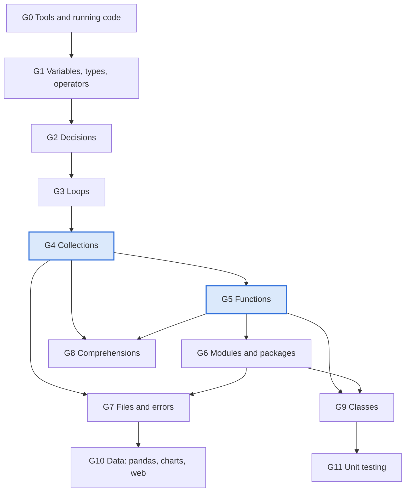

# Learning Goals Catalogue

15 Oct 2026 · Defines **what** the course teaches. The teaching guideline (`02`) defines how, the
course plan (`03`) assigns these goals to units. IDs in this document are stable and are referenced
from unit front matter, checks and reviews.

## Audience and entry level

- **Who:** working adults in technical presales, process engineering, economics, marketing and
  similar roles. Strong domain knowledge, daily spreadsheet users, comfortable with formulas,
  filters and pivot tables.
- **Entry level:** no programming experience and little IT background. Nothing in this catalogue
  is assumed known; the course is standalone.
- **Exit level:** can turn a messy CSV export into cleaned, aggregated, plotted results with pandas,
  write and test small reusable functions and classes, and read other people's Python. This is the
  entry level for a later data-analytics course.

## Goal groups and dependencies

Twelve goal groups, ordered by dependency. A group needs only the groups listed under *Requires*.
G4 Collections and G5 Functions are the bottleneck: every group from level 3 on requires at least
one of them, so they get the most practice time (see R3 in the course plan).

| Level | Groups | Theme |
| --- | --- | --- |
| 0 | G0 | Working environment |
| 1 | G1, G2, G3 | Language basics |
| 2 | G4, G5, G6 | Organising data and code |
| 3 | G7, G8, G10 | Working with real data |
| 4 | G9, G11 | Structuring and securing code |

**Depth.** Every bullet below is *practised* (the learner writes it in exercises) unless marked
*(recognise)*, which means the learner can read and explain it when it appears in someone else's
code but is not required to write it.

## Learning goals by group

### G0 Tools and running code · Requires: nothing · Taught in U0, U10

- Run, edit and stop a code cell on a lesson page and in the notebook workspace.
- Know that cells run top to bottom and that a changed cell must be re-run; use "Restart & Run All" (M16).
- Write comments with `#` and docstrings with `"""`.
- Tell a notebook (`.ipynb`) from a script (`.py`) and know when each is used.
- Run a script with `%run file.py` in the workspace; know what `python file.py` in a terminal does *(recognise)*.

### G1 Variables, data types, operators · Requires: G0 · Taught in U1, U2

- Assign values with `=` (the right side is computed, then the name is attached); reassign; use `+=`.
- Explain a variable as a name tag on a value, not a box that holds history (M1).
- Use the arithmetic operators `+ - * / // % **` and explain `/` vs `//`.
- Name the basic types `int`, `float`, `str`, `bool` and check them with `type()`.
- Convert between types with `int()`, `float()`, `str()`; know that text from files and `input()` is always `str` (M10).
- Explain floating-point inaccuracy (`1.2 - 1.0`) and use `round()`.
- Build text with f-strings, including format specs such as `f"{price:.2f}"` and `f"{share:.1%}"` (X1).
- Use the string methods `.strip() .lower() .upper() .replace() .split() .join()` and know that they return a new string (M6, X2).
- Index and slice text: `text[0]`, `text[-1]`, `text[0:4]`, `text[::-1]`; use `len()` and `in` (X3).
- Follow naming rules and the convention of lowercase names with underscores.
- Know what `input()` does and why exercises here use variables instead *(recognise)*.

### G2 Decisions · Requires: G1 · Taught in U3

- Use `True`/`False` and the comparison operators `== != > < >= <=`; tell `=` from `==` (M2).
- Write `if`, `elif`, `else` blocks; explain that indentation defines the block (M3).
- Explain why separate `if`s differ from an `if/elif` chain (M5).
- Combine conditions with `and`, `or`, `not`; nest conditions; read a truth table.

### G3 Loops · Requires: G2 · Taught in U4

- Use `for` with `range(start, stop, step)`; know that `stop` is excluded (M4).
- Use `for item in items` over a list (previewed here, practised in G4).
- Build the accumulator pattern: `total = 0` before the loop, `total += x` inside.
- Use `while` when the number of repetitions is unknown; avoid or deliberately end infinite loops; use the Stop button.
- Control loops with `break` and `continue`.
- Read nested loops (rows × columns, like a spreadsheet) *(recognise)*.

### G4 Collections · Requires: G3 · Taught in U5, U6

- Lists: create, index from 0, negative index, slice `[start:end]`, `append`, `insert`, `extend`, `remove`, `del`.
- Use `len`, `sum`, `min`, `max`, `sorted`, `in` on lists; loop with `for item in items`.
- Tuples: ordered and unchangeable; the one-element tuple `("x",)`; unpacking `a, b = pair`; named tuples *(recognise)*.
- Dictionaries: key–value access, `.get()`, add/update/delete keys, loop with `.items()`, nested data; `pprint` for nested data.
- Treat a list of dictionaries as a table of rows and a dictionary of dictionaries as a lookup table.
- Sets: unique elements, `add`, `remove` vs `discard`, union, intersection, difference.
- Choose the right collection (ordered? changeable? duplicates? lookup by key?).
- Explain reference vs copy: `b = a` for a list shares the object; `list(a)` and `copy.deepcopy` make copies (M7).

### G5 Functions · Requires: G4 · Taught in U7

- Define with `def` and call a function; follow the order of execution (a function runs only when called, M9).
- Distinguish parameters (in the definition) from arguments (in the call).
- Return values with `return`; know that `print` is not `return` (M8) and that no `return` means `None`.
- Use multiple parameters, default values and keyword arguments.
- Explain local vs global scope and why returning a value beats `global`.
- Validate input and signal a problem with `raise ValueError("...")` (X4).
- Write a one-line docstring.
- Recognise `*args` and `**kwargs` *(recognise)*.

### G6 Modules and packages · Requires: G5 · Taught in U10

- Explain statement, script, module, package, library.
- Import with `import x`, `import x as y`, `from x import name`; know why `from x import *` is avoided *(recognise)*.
- Use standard modules `math`, `random`, `datetime`, `csv`, `os`.
- Install packages with `%pip install` in the browser workspace; know `pip`, `conda`, PyPI and `requirements.txt` on a real machine *(recognise)*.
- Write your own module (`quote_tools.py`) with functions and constants, and import it.
- Use the `if __name__ == "__main__":` guard and a `main()` function.
- Use terminal basics: current folder, `cd`, running a file *(recognise, X8)*.

### G7 Files, folders and errors · Requires: G4, G6 · Taught in U8

- Use relative paths; use `os.path.exists`, `os.listdir`, `os.getcwd`; know `mkdir`, `remove`, `rmdir` *(recognise)*.
- Open files with modes `r`, `w`, `a`; read with `read()`, `readlines()` or line by line; write with `write()`.
- Always use the `with open(...)` context manager.
- Read and write CSV with `csv.reader`, `csv.DictReader`, `csv.writer`, a `delimiter` and `newline=""`.
- Convert text fields to numbers, including decimal commas (`"12,5".replace(",", ".")`) (M10).
- Explain ASCII, UTF-8 and Windows-1252 and pass `encoding=` when a read fails.
- Handle errors with `try / except`; catch specific errors such as `FileNotFoundError` and `ValueError`; recognise `else` / `finally` *(recognise)*.

### G8 Comprehensions · Requires: G4, G5 · Taught in U9

- Rewrite a `for` + `append` loop as `[expr for x in items]` and back.
- Filter with `if`, transform with `a if cond else b`.
- Use `enumerate()` and dictionary comprehensions; set comprehensions *(recognise)*.
- Use `any()` and `all()` with a generator expression (X7).
- Read nested comprehensions and translate them back into loops *(recognise)*.

### G9 Classes and objects · Requires: G5, G6 · Taught in U14

- Explain class, object (instance), attribute, method; tell the class `Pump` from an instance `Pump(...)`.
- Write `__init__` and use `self`; add `__str__` for readable output.
- Write methods that change an object's state.
- Use `@property` with a setter that validates input and raises `ValueError` (X4, X6).
- Use `@classmethod` as an alternative constructor, e.g. from a CSV row; `@staticmethod` *(recognise)*.
- Distinguish class attributes (shared) from instance attributes.
- Apply encapsulation by convention: `_protected`; know `__private` *(recognise)*.
- Use simple inheritance: a subclass that extends a base class and calls `super().__init__()` (X5).
- Recognise operator overloading with `__add__`, `__eq__` *(recognise)*.

### G10 Data: pandas, charts and web data · Requires: G4, G6, G7 · Taught in U11, U12, U13

Load and inspect

- Load a CSV into a `DataFrame` with `pd.read_csv(path, sep=";", decimal=",", encoding=...)`.
- Inspect with `head()`, `info()`, `describe()`, `shape`, `columns`, `dtypes`.
- Select columns (`df["col"]` gives a Series, `df[["a", "b"]]` a DataFrame, M13), rows with `loc`, filter with Boolean masks using `&`, `|`, `~` and parentheses (M12), sort with `sort_values`.

Clean and transform

- Fix text columns with `.str.strip()`, `.str.capitalize()`, `.str.replace()`.
- Convert types and dates with `astype` and `pd.to_datetime(..., format="%d.%m.%Y")`.
- Find and remove duplicates with `duplicated` / `drop_duplicates`.
- Handle missing values with `isna`, `fillna`, `dropna`.
- Know that methods return a new object; assign the result (M11); avoid chained assignment (M14).
- Derive new columns from existing ones (quote value, margins, unit conversions, kWh/m³).

Aggregate, combine, export

- Group and aggregate with `groupby` and `agg`; build an Excel-style pivot with `pivot_table`.
- Aggregate time series by month with `resample` or `dt.month`.
- Combine tables with `merge` (the `VLOOKUP` equivalent) and `concat`.
- Save results with `to_csv` and `to_excel`.

Charts

- Plot bar and line charts from a DataFrame with `df.plot`, add title and axis labels, handle a date axis.
- Use a chart as a check after cleaning or aggregation (outliers, gaps).

Web data

- Fetch a URL with `requests.get()`, check `status_code`, turn the response into dicts and lists with `.json()`.
- Pick values out of nested JSON and load them into a DataFrame.
- Send query parameters; understand API keys and rate limits *(recognise)*; fall back to a saved snapshot.

### G11 Unit testing · Requires: G5, G6, G9 · Taught in U15

- Explain why tests make code safer to change, and why a passing test is not a proof (M15).
- Write a test class inheriting from `unittest.TestCase` with methods starting with `test_` (X5).
- Use `assertEqual`, `assertAlmostEqual`, `assertTrue`, `assertFalse`, `assertIn`, `assertRaises`.
- Test normal values, edge cases (empty list, zero, missing value) and expected errors.
- Separate code and tests into files and a `tests/` folder; run tests in the workspace and know the terminal command `python -m unittest discover -s tests -v` *(recognise)*.

## Cross-cutting skills

These were "hidden prerequisites" in the original course: used by many topics, explained by none.
Here each one is taught explicitly in the unit listed, before any later unit uses it.

| ID | Skill | Taught in | Needed from |
| --- | --- | --- | --- |
| X1 | f-strings with format specs | U2 | U3 onwards |
| X2 | String methods `.strip() .lower() .replace() .split() .join()` | U2 | U8, U11 |
| X3 | String slicing | U2 | U5 (list slicing reuses it), U8 |
| X4 | `raise ValueError` to signal bad input | U7 | U14, U15 |
| X5 | Inheritance syntax `class A(B)` and `super()` | U14 | U15 (`unittest.TestCase`) |
| X6 | Decorators as syntax (`@property`, `@classmethod`) | U14 | U14 |
| X7 | `any()` / `all()` with a generator expression | U9 | U15 |
| X8 | Terminal basics: current folder, `cd`, `python file.py` | U10 | U15 |

## Misconception register

Known novice misconceptions that units target explicitly (principle P9). Each unit names at least one
ID in its front matter and tests it in the exit check.

| ID | Misconception | Correct model | Targeted in |
| --- | --- | --- | --- |
| M1 | A variable is a box that keeps its history or several values | A variable is a name tag attached to one value; reassignment moves the tag | U1 |
| M2 | `=` tests equality | `=` assigns, `==` compares | U3 |
| M3 | Indentation is cosmetic | Indentation defines which lines belong to a block | U3, U4 |
| M4 | `range(1, 10)` includes 10 | The stop value is excluded | U4 |
| M5 | A chain of separate `if`s behaves like `if/elif` | Separate `if`s are all evaluated; `elif` stops at the first match | U3 |
| M6 | `name.strip()` changes `name` | String methods return a new string; assign the result | U2 |
| M7 | `b = a` copies a list | Both names point at the same list; use `list(a)` or `copy` to copy | U5, U6 |
| M8 | `print(x)` inside a function is the same as `return x` | `print` shows, `return` hands the value back to the caller | U7 |
| M9 | A function runs when it is defined; its variables exist outside | A function runs only when called; local names vanish afterwards | U7 |
| M10 | Values read from a file or `input()` are numbers | Everything read is text until converted with `int()`/`float()` | U1, U8 |
| M11 | `df.dropna()` changes `df` | pandas methods return a new object; assign it | U11 |
| M12 | `and` / `or` work in pandas filters | Use `&`, `|`, `~` with parentheses around each condition | U11 |
| M13 | `df["col"]` and `df[["col"]]` are the same | Series vs DataFrame; different methods and display | U12 |
| M14 | Changing a filtered slice changes the original | Chained assignment warns and may not write; use `loc` on the original | U12 |
| M15 | A passing test proves the code is correct | A test proves only the cases it checks; test edge cases and errors | U15 |
| M16 | Cells can be run in any order without consequence | Notebook state depends on run order; run top to bottom before trusting results | U0, U16 |

Note: "class vs instance" (U14) uses M9 as its exit check base ("which code runs when?") and
tests `Pump` vs `Pump(...)` directly; no separate ID is needed.

## Bridges to spreadsheet work

Authors use these mappings in the "Why" step and in explanations (principle P6). Every new concept is
introduced against the spreadsheet action the learner already performs.

| Python concept | Familiar equivalent |
| --- | --- |
| Variable | Named cell |
| `if / elif / else` | `IF()` / nested `IF()` |
| `for` loop over a list | Filling a formula down a column |
| List | One column of values |
| Dictionary | Lookup table, product catalogue by article number (`VLOOKUP`) |
| List of dictionaries | A table of rows |
| Function | Reusable formula or calculation sheet with inputs and one result |
| Module / package | Add-in or template library |
| `with open` + `csv` | Excel import/export wizard |
| `try / except` | `IFERROR()` |
| DataFrame | A worksheet with a header row |
| Boolean mask filter | AutoFilter |
| `groupby` / `pivot_table` | Pivot table |
| `merge` | `VLOOKUP` / `XLOOKUP` across sheets |
| Class with `@property` | Equipment datasheet with derived values |
| Web API + JSON | Live price, weather or process-historian feed |
| Unit test | Checking a calculation sheet against known reference cases |

## Origin

The goal groups were derived from a topic inventory of an existing five-block Python course (17
notebooks: intro, fundamentals, classes and requests, own modules, unit tests). That course served
only as a checklist of topics. No text, code or data from it is used here (R15).
