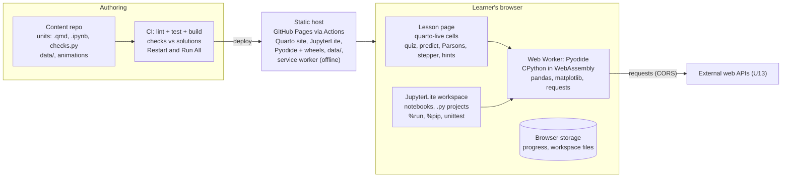

# Platform Specification

15 Oct 2026 · Defines **on what** the course runs: the learner experience, the technical architecture,
the tooling and the authoring workflow. Course content is defined in `01`–`03`; this document makes it
buildable.

## Platform goal

Open a link, start learning. A static website teaches the whole course in the browser: Python runs
locally via WebAssembly (Pyodide), so learners install nothing, need no account and send no code to a
server. Only the web-API calls of U13 leave the machine.

- **In scope:** lesson pages with the unit pattern as reusable components, live code cells,
  animated explanations, automatic exercise checking, a notebook workspace for Make tasks and
  `.py` projects, progress in the browser, an offline package for workshops, an instructor mode.
- **Hosting:** GitHub Pages from the repository `mriedmann/python-course`, built by GitHub Actions. **Language:** English.
- **Non-goals:** user accounts, grading databases, an LMS, a multi-language UI, mobile editing.

## Learner experience

Every unit page renders the steps of the unit pattern (teaching guideline) as components, in order,
under a progress bar. Each exercise checks itself in the browser.

| Step | Component | Check | Notes |
| --- | --- | --- | --- |
| 1 Warm-up | Quiz card: 3–5 multiple-choice or short-answer questions | Auto-marked, score shown | Code cells on the page stay collapsed until the quiz is submitted |
| 2 Why | Work-problem card: one paragraph plus a spreadsheet screenshot | none | |
| 3 Worked example | Animation (Back / Next / Play, silent) with subgoal labels, then an empty live cell the learner types into | Learner presses Run; a "show me" button reveals the code after the animation was stepped through once | Shows state: name tags on values, list slots, a DataFrame before and after `groupby` |
| 4 Predict and run | Prediction field locked in before the Run button is enabled; answer then revealed | Prediction vs actual output | |
| 5 Parsons | Drag-and-drop lines with indentation into a cell, then run | Output or hidden check | Up to two distractor lines allowed |
| 6 Modify | Editable copy of the worked example with a new question | Hidden asserts | |
| 7 Make | Skeleton cell on the anchor dataset, or a notebook in the workspace for larger tasks | Hidden asserts; in the workspace only after "Restart & Run All" | |
| 8 Exit check | One misconception question | Auto-marked | |

Component rules:

- **Feedback ladder:** a failed check shows one plain-language sentence, then up to three hints one
  at a time, then the solution (after the third hint or two failed attempts).
- **Error messages:** tracebacks are shown in full with a plain-language explanation above them,
  built on the Raspberry Pi `python-friendly-error-messages` rules plus unit-specific additions.
- **Stepper:** every live cell has a "Step through" button that shows variables and references
  line by line (Python Tutor style).
- **Pacing:** the progress bar shows the eight steps; a check occurs at least every 15 minutes.
- **Progress:** stored in `localStorage` only, with export and import as a JSON file.
- **Instructor mode:** a URL flag hides all hints and solutions and enables a large-font presenter
  toggle, so a trainer can live-code without spoilers in a workshop.
- **Workspace:** a JupyterLite tab with the `data/` folder and the `.py` projects preloaded, a
  "Restart & Run All" button, and upload/download for the learner's own files.

## Technical architecture

The platform is a static site: a server or USB stick hands out files once, and all Python runs in a
Web Worker inside the learner's browser.



- **Runtime:** Pyodide in a dedicated Web Worker; the page talks to it by message passing, so the
  Stop button can terminate a runaway loop. Lesson pages and the workspace each start their own
  worker but load the same self-hosted Pyodide build and the same `data/` folder.
- **Editor:** CodeMirror 6 (shipped with quarto-live) with highlighting and autocomplete. The
  workspace uses JupyterLab's editor.
- **Checker:** each exercise runs the learner's code, then the unit's hidden `checks.py` in the
  same namespace. The result is pass/fail plus a message key that selects the hint ladder.
- **Packages:** numpy, pandas, matplotlib and requests are preloaded from the self-hosted Pyodide
  distribution; no PyPI or CDN calls at runtime.
- **`input()`:** blocking `input()` needs cross-origin isolation headers that GitHub Pages cannot
  send. Decision: `input()` is taught as "recognise" only and no exercise depends on it. A
  `coi-serviceworker` shim may be added later for demos; it is not a gate criterion.

## Tooling

Decision: lesson pages are built with Quarto plus the quarto-live extension, the workspace is
JupyterLite, both run Pyodide. Custom components (quiz, predict-lock, Parsons, animation, later the stepper) are small
vanilla JavaScript add-ons written as fenced divs and processed by one Lua filter (shortcodes cannot
take a body; decided in the PoC). The decision is confirmed or reversed at gate G-A.

| Tool | Role | Why | Watch out |
| --- | --- | --- | --- |
| [Pyodide](https://pyodide.org) | Python runtime (CPython in WebAssembly) | Real CPython; numpy, pandas, matplotlib work; `requests` works natively since 0.25 | Large first download; packages must be Pyodide builds |
| [quarto-live](https://github.com/r-wasm/quarto-live) | Lesson pages: live cells, exercises, hints, solutions, custom grading | Lessons are Markdown; grading is Python; MIT | 0.1.x dev version, pin the exact version; verify it can load a self-hosted Pyodide |
| [JupyterLite](https://jupyterlite.readthedocs.io) + pyodide kernel | Workspace: Make notebooks, `.py` projects (U10, U15), final task | Real `.ipynb` files (R9); `%pip install`; file browser | Heavier UI; kernel and Pyodide versions are strictly paired |
| Own Parsons component (`site/components/parsons.js`) | Parsons problems (step 5) | Native drag-and-drop plus keyboard, no dependency | Replaced js-parsons in the PoC: it needs jQuery UI and is more code than the widget |
| [futurecoder](https://github.com/alexmojaki/futurecoder) | Reference design, not deployed | Hint ladder, predict-the-output and Parsons proven with beginners | Generic content; adapting its engine is a larger job |
| [live-py-tutor](https://github.com/livinNector/live-py-tutor) / Python Tutor | "Step through" stepper | Shows name tags pointing at objects (P9) | A fork; embed in an iframe so it can be swapped |
| [python-friendly-error-messages](https://github.com/RaspberryPiFoundation/python-friendly-error-messages) | Plain-language error explanations | Built for Pyodide | Generic; add unit-specific explanations |
| Animation | Concept explainers (step 3) | Hand-built SVG with step controls; Manim videos for complex ones | Decide after the PoC shows what a page needs; avoid Motion Canvas (maintenance) |

Alternatives considered and not chosen:

- **pyodide-mkdocs-theme:** strong test runner and quiz support, documentation in French only.
  Fallback if quarto-live fails gate G-A.
- **marimo WebAssembly export:** good for slider demos, no exercise checking. Optional explorations only.
- **PyScript / Papyros:** building blocks for a fully custom site. Fallback if both Quarto and MkDocs fail.
- **Skulpt, Brython, MicroPython:** not real CPython, no pandas (R6).
- **Hedy, Capytale/Basthon:** aimed at schools or hosted French platforms.

## Repository layout

```text
README.md
pyproject.toml, uv.lock    Python dependencies, managed with uv (see roadmap)
docs/                      specification set
data/                      generated datasets, data card (CC0); api/ snapshots for U13
tools/generate_datasets.py seeded, reproducible generator
site/                      Quarto project (created in the PoC)
  _quarto.yml              site config; pinned quarto-live and Pyodide versions
  units/
    07-functions/
      index.qmd            lesson page: steps in order, front matter with IDs
      make.ipynb           Make task for the workspace (full-pattern units)
      checks.py            hidden asserts for Modify and Make
      solution.py          reference solutions; never shipped in instructor mode
      anim/                step-through animation (SVG + JS or video)
  components/              quiz, predict-lock, parsons, stepper (JS, shared)
  workspace/               JupyterLite build config, .py projects (U10, U15)
  _extensions/             quarto-live (pinned)
.github/workflows/         lint, test, build, deploy to GitHub Pages
tests/                     CI: run every solution against its checks, lint front matter
archive/                   original drafts
```

## Authoring rules

Authors write Markdown and Python only; adding a unit needs no JavaScript.

- **Front matter** carries the IDs the course plan requires (R10):

  ```yaml
  unit: U7
  title: "Functions: a reusable formula"
  duration_min: 45
  pattern: full
  goals: [G5, X4]
  misconceptions: [M8, M9]
  retrieves: [U3, U5, U6]
  new_concept: "defining and calling a function"
  ```

  The build fails if an ID is unknown, a step of the pattern is missing, or the duration is outside
  the unit limits.
- **Exercises** use quarto-live `{pyodide}` blocks with `exercise:` labels, `setup` blocks and
  `check: true` grading. Hints and solutions are separate blocks revealed in order.
- **Quiz, predict, Parsons and animation** use fenced divs, e.g. `::: {.parsons #loop-sum}` with the
  correct lines as a code block inside; the component shuffles them. The syntax is documented in
  `site/units/README.md`. Quiz questions carry the goal or
  misconception ID they test.
- **Checks** are plain asserts with a learner-facing message:
  `assert total == 42.5, "Check the unit: the price is per piece, multiply by quantity"`.
- **Data before U8:** units U5–U7 get their data from a hidden setup block that defines `quotes`
  (first 20 rows as a list of dicts) and `products` (dict by ID). From U8 on, code reads `data/`
  files by relative path. Learners never download files during a unit.
- **Animations** are step-through, silent, with Back / Next / Play and a text alternative.

## Quality gates in CI

Run on every commit:

1. Lint front matter and page structure against the Unit Definition of Done (IDs, steps, warm-up
   size, checks every 15 min, duration limits).
2. Execute every `solution.py` against its `checks.py` under CPython and under Pyodide (headless
   browser).
3. Run each `make.ipynb` top to bottom ("Restart & Run All").
4. Build the site and smoke-test one exercise per unit with Playwright.

## Browser constraints and workarounds

| Course need | Browser behaviour | Handling |
| --- | --- | --- |
| `input()` (G1) | Blocks only with cross-origin isolation, which GitHub Pages cannot provide | Taught as "recognise"; no exercise uses it |
| Terminal, `python file.py`, `cd` (G0, G6) | No real shell | `%run main.py` in the workspace; real-terminal steps as a recorded demo |
| `pip` / `conda` / `requirements.txt` (G6) | `%pip install` works only for pure-Python wheels and Pyodide builds | Teach `%pip` in the browser; compare with `pip` on a real machine in one slide |
| `os`, files, folders (G7) | Virtual file system, not the learner's disk | Ship `data/` in the workspace; changes persist in browser storage; upload/download buttons |
| `requests` to web APIs (G10) | Works if the API allows CORS | Choose CORS-enabled public APIs; snapshot JSON in `data/api/` as fallback |
| `unittest discover -s tests` (G11) | No CLI | `unittest.main(argv=["", "discover", "-s", "tests", "-v"], exit=False)` in a cell |

## Non-functional requirements

- **Zero install (R16):** works in current Chrome, Edge, Firefox and Safari on a standard laptop.
  Mobile is view-only.
- **Hosting:** a public GitHub Pages site built by GitHub Actions on every push to `main`. Pages
  limits are 1 GB per site and a soft 100 GB/month bandwidth, so only the Pyodide packages the course
  uses are self-hosted. Target total site size under 300 MB.
- **Offline:** a service worker caches the site, Pyodide and all packages after the first visit.
  A workshop package (built site plus a small static server) runs from a USB stick; it does not run
  from `file://`.
- **Load time:** the first Python cell is ready within 15 s on a 50 Mbit/s connection; pandas loads
  in the background during the warm-up quiz. Verified in the PoC.
- **Robustness:** code runs in a Web Worker with a Stop button, so an infinite loop never freezes
  the page.
- **Version pinning:** Pyodide, quarto-live and the JupyterLite kernel are pinned together;
  upgrades go through CI.
- **Privacy:** no cookies, no analytics, no code leaves the browser except the learner's own API
  calls in U13. All data is artificial, so a public site is safe.
- **Accessibility:** keyboard-operable editor and Parsons widget, animations with text alternatives
  and no autoplay, WCAG 2.1 AA contrast.

## Sources

- [Pyodide documentation](https://pyodide.org) and [Pyodide 0.25 release (native requests)](https://blog.pyodide.org/posts/0.25-release/)
- [Pyodide WebAssembly constraints](https://pyodide.org/en/stable/usage/wasm-constraints.html)
- [urllib3 on Pyodide/Emscripten](https://urllib3.readthedocs.io/en/stable/reference/contrib/emscripten.html)
- [quarto-live (GitHub)](https://github.com/r-wasm/quarto-live) and [Quarto Live 0.1.1 announcement](https://tidyverse.org/blog/2024/10/quarto-live-0-1-1/)
- [jupyterlite-pyodide-kernel (PyPI)](https://pypi.org/project/jupyterlite-pyodide-kernel/)
- [futurecoder (GitHub)](https://github.com/alexmojaki/futurecoder)
- [pyodide-mkdocs-theme (PyPI)](https://pypi.org/project/pyodide-mkdocs-theme/)
- [marimo WebAssembly HTML export](https://docs.marimo.io/guides/exporting/webassembly_html/)
- [Papyros (npm)](https://www.npmjs.com/package/@dodona/papyros)
- [ProblemSolvingIO/parsons, built on js-parsons](https://github.com/ProblemSolvingIO/parsons)
- [live-py-tutor](https://github.com/livinNector/live-py-tutor)
- [python-friendly-error-messages (Raspberry Pi Foundation)](https://github.com/RaspberryPiFoundation/python-friendly-error-messages)
- [GitHub Pages limits](https://docs.github.com/en/pages/getting-started-with-github-pages/github-pages-limits)
- [PyScript FAQ: cross-origin isolation and mini-coi](https://docs.pyscript.net/latest/faq/)
- [Allow setting COOP and COEP headers in GitHub Pages (community discussion)](https://github.com/orgs/community/discussions/13309)
