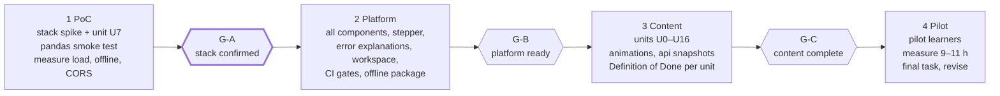

# Roadmap, PoC and Decisions

15 Oct 2026 · Defines the build order, the gates between phases, the first proof of concept (PoC) in
enough detail to start it, and the decisions taken so far.

## Phases and gates

Four phases, three gates. The PoC tests the riskiest technical choices before content is written at
scale. No calendar dates are set; the content volume is fixed by the 10-hour budget (R12).



| Gate | Pass criteria |
| --- | --- |
| G-A stack confirmed | All PoC acceptance criteria below hold. If quarto-live fails, lesson pages switch to pyodide-mkdocs-theme and the PoC is repeated on that stack. |
| G-B platform ready | All eight step components exist as shortcodes. The stepper and error explanations work on any cell. The JupyterLite workspace runs with `data/` and the `.py` projects preloaded. The GitHub Actions workflow runs all four CI quality gates and deploys to Pages. The published site is under 300 MB. The offline workshop package runs on a standard Windows laptop without admin rights. Instructor mode hides all hints and solutions. |
| G-C content complete | Units U0–U16 pass the Unit Definition of Done. Every goal group G0–G11, skill X1–X8 and misconception M1–M16 is covered by at least one unit. The anchor dataset is used as planned. The retrieval map is implemented. A review confirms no text or code is copied from the original course notebooks (R15). |
| Pilot exit | Pilot learners complete the final task (R11) in the browser alone. Measured learner work time is 9–11 h. Feedback is collected per unit and the plan is revised. |

## Phase 1: the PoC

**Goal.** Prove the chosen stack with one complete unit and a pandas smoke test, and measure the
non-functional targets, so that gate G-A can be decided on evidence.

**Scope.**

1. A Quarto site in `site/` with the quarto-live extension and a pinned Pyodide version.
2. Unit **U7 Functions** as a complete lesson page: all eight steps, hidden checks, three hints and
   a solution per exercise, one exercise that starts from a real traceback, a quiz, a predict-lock
   and a Parsons component. The animation for step 3 may be a static placeholder with Next/Back
   over three hand-drawn frames; the component API is what matters.
3. A **pandas smoke page** (not a unit): read `data/quotes.csv` with `sep=";", decimal=","` and
   `data/customers.csv` with `encoding="cp1252"` in the browser, show `head()`, one `groupby`,
   one `merge` and one chart.
4. A **web smoke cell**: `requests.get` against the two candidate APIs for U13 (see open
   questions) from the deployed page, to verify CORS.
5. Deployment to GitHub Pages through a GitHub Actions workflow, with a service worker for offline use.
6. A one-page **G-A report** with the measurements and a pass/fail per criterion.

Not in the PoC: JupyterLite workspace, stepper, error explanations, instructor mode, other units.

**Acceptance criteria (gate G-A).** All met on 15 Oct 2026, see `docs/reports/g-a_report.md`.

- [x] A quarto-live Python exercise with a hidden check, hint ladder and solution reveal works in Chrome and Firefox.
- [x] The quiz, predict-lock and Parsons components run inside the Quarto page and report pass/fail; results survive a reload (`localStorage`).
- [x] U7 passes the Unit Definition of Done (reviewer check; the CI lint can follow in phase 2).
- [x] pandas reads both CSV files in the browser, including the Windows-1252 file, and a matplotlib chart renders.
- [x] The first Python cell is ready within 15 s on a 50 Mbit/s connection (Chrome DevTools throttling), measured on the deployed site.
- [x] Total site payload under 300 MB; the Pyodide build and wheels are self-hosted, or quarto-live's CDN loading is documented as a known deviation to fix at G-B.
- [x] The site works offline after the first visit (service worker).
- [x] The Stop button terminates `while True: pass`.
- [x] The two candidate APIs answer `requests.get` from the deployed page (CORS), or a snapshot fallback is confirmed necessary.
- [x] The G-A report is written and the decision (confirm quarto-live or switch) is recorded in the decision log.

**Suggested timebox:** five working days. If the first two criteria are not met after two days, start
the pyodide-mkdocs-theme comparison in parallel.

**Task list.**

1. Install the toolchain (below). Create `site/` with `quarto create project website`, add
   quarto-live with `quarto add r-wasm/quarto-live`, set `engine: pyodide` and the package list
   (pandas, matplotlib, requests) in `_quarto.yml`. Pin the quarto-live and Pyodide versions.
2. Write `site/units/07-functions/index.qmd` from the course plan row for U7, following the
   teaching guideline step by step. Write `checks.py` and `solution.py`. Verify
   `solution.py` passes `checks.py` under CPython (`pytest` or a plain script in `tests/`).
3. Build the three components in `site/components/` as Quarto shortcodes: `quiz`, `predict`,
   `parsons` (wrap js-parsons). Keep each under 200 lines; no framework.
4. Write the pandas smoke page and the web smoke cell.
5. Add `.github/workflows/deploy.yml` (Quarto render, upload to Pages) and a service worker.
   Deploy to the GitHub Pages site of `mriedmann/python-course`.
6. Measure load time, payload size, offline behaviour, Stop button and CORS. Write the G-A report
   in `docs/reports/g-a_report.md`.

**Toolchain on the development machine.** All Python dependencies are managed with
[uv](https://docs.astral.sh/uv/) in a project virtual environment; nothing is installed into the
system Python. `pyproject.toml` at the repository root declares them, `uv.lock` pins them.
(Checked 15 Oct 2026 on this WSL2 system: Python 3.12, uv 0.9, Node 24 and git are present;
Quarto is not.)

```bash
# Quarto CLI (1.6 or newer), see https://quarto.org/docs/get-started/
# Python: create .venv and install pandas, matplotlib, requests, pytest from the lock file
uv sync
# run anything inside the environment
uv run python tools/generate_datasets.py
uv run pytest
# add a dependency (updates pyproject.toml and uv.lock)
uv add --dev jupyterlite-core jupyterlite-pyodide-kernel playwright   # phase 2
```

CI uses the same lock file (`uv sync --frozen`), so local and CI environments match.

## Phase 2: platform

Build the remaining components (stepper, error explanations, instructor mode, progress export),
the JupyterLite workspace with `data/` and `.py` projects, the four CI quality gates, the offline
workshop package and the front-matter lint. Exit at G-B.

## Phase 3: content

Write U0–U16 in dependency order against the Unit Definition of Done, generate the U13 API
snapshots into `data/api/`, produce the animations, implement the retrieval map. Exit at G-C.

## Phase 4: pilot

Run the course with a pilot group, measure work time per unit, collect feedback per unit, revise
the plan and the units. Exit when the pilot criteria hold.

## Decision log

| Date | Decision | Reason |
| --- | --- | --- |
| 15 Oct 2026 | Pinned PoC stack: Quarto 1.10.19, quarto-live v0.2.0, Pyodide 0.28.1 (the version quarto-live 0.2.0 hard-codes) | Exact versions found in the stack spike (T1); upgrades go through CI |
| 15 Oct 2026 | Components (quiz, predict, Parsons, animation) are **fenced divs handled by one Lua filter** plus vanilla JS, not shortcodes; Parsons is built natively (HTML drag-and-drop + keyboard), not by wrapping js-parsons | Quarto shortcodes cannot take a body; js-parsons needs jQuery/jQuery UI, which is more code than the widget itself |
| 15 Oct 2026 | Hidden checks live once in each unit's `checks.py` (`check_<label>(ns)`), included into quarto-live check blocks through `components/check.py`; `solution.py` holds the reference solutions and is tested under CPython | Single source of truth, testable in CI |
| 15 Oct 2026 | PoC Stop button reloads the page (quarto-live 0.2.0 has no interrupt; GitHub Pages cannot enable cross-origin isolation). Known limit: edits on the page are lost | Smallest fix that meets the robustness criterion; revisit at G-B |
| 15 Oct 2026 | **Gate G-A passed: quarto-live stack confirmed.** Known deviation: Pyodide loads from jsDelivr until self-hosted at G-B; Google Fonts to be removed at G-B | All ten criteria met on the deployed site (`docs/reports/g-a_report.md`); first cell ready in 11–12.5 s at 50 Mbit/s |
| 15 Oct 2026 | U13 APIs confirmed: Frankfurter (`api.frankfurter.dev/v1`) and Open-Meteo answer from the github.io origin | Measured in the PoC (T8) |
| 15 Oct 2026 | **Standalone course**, not an addition to the existing course. Basics G0–G3 get full units; budget 10 h | Learners have no programming experience; a 25-minute refresher cannot carry them |
| 15 Oct 2026 | **Self-paced first.** Every unit works alone in the browser; instructor mode is optional | Platform promise "open a link, start learning" |
| 15 Oct 2026 | **PoC = stack spike + one full unit (U7) + pandas smoke test** | Tests the riskiest choices with the least content |
| 15 Oct 2026 | `input()` is taught as "recognise" only; no exercise depends on it; cross-origin isolation shim is optional | Removes a fragile dependency on GitHub Pages headers |
| 15 Oct 2026 | Unit order: text before decisions; collections split into two units; comprehensions after files | f-strings are needed everywhere; collections are the biggest jump; comprehensions want real rows |
| 15 Oct 2026 | Candidate APIs for U13: Frankfurter (exchange rates, EUR to CZK/HUF/CHF) and Open-Meteo (weather at a plant site); both keyless and CORS-enabled by reputation, verified in the PoC | Domain fit (quote values in customer currency) and no API keys for learners |
| earlier | Anchor dataset is artificial and generated: the Fluvia quote book plus side datasets, CC0 | No copyright or privacy risk; no open B2B equipment dataset in German Excel format exists |
| earlier | Course language English | Course owner decision |
| 15 Oct 2026 | Repository `mriedmann/python-course` on GitHub; Pages site built from it | Course owner decision |
| 15 Oct 2026 | Python dependencies via uv in a project virtual environment (`pyproject.toml`, `uv.lock`); no system installs | Reproducible local and CI environments |
| earlier | Hosting on GitHub Pages via GitHub Actions | Free, static, CI-friendly |
| earlier | Classes (G9) and unit testing (G11) mandatory | Needed for the follow-up course |
| earlier | Original content only; existing notebooks used as a topic checklist | Copyright |
| earlier | Lesson pages with Quarto + quarto-live, workspace with JupyterLite, both on Pyodide; confirmed or reversed at G-A | Markdown authoring, Python grading, real notebooks |

## Open questions

- [x] Confirm the two U13 APIs (Frankfurter, Open-Meteo) from the deployed page: both answer (G-A report).
- [ ] Animation technique for step 3 (hand-built SVG vs Manim video): decide after the PoC shows what a unit page needs.
- [ ] Pilot group and timing for phase 4.
- [x] Does quarto-live accept a self-hosted Pyodide `indexURL`? Yes: `pyodide: engine-url:` in `_quarto.yml` replaces the `indexURL`; the copy must be exactly Pyodide 0.28.1 (found in T1 from the source, not yet exercised).
