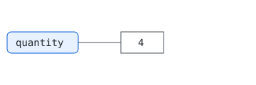
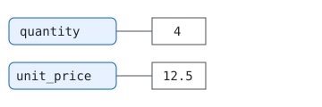
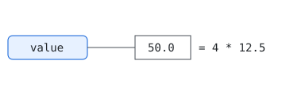

## Warm-up

::: {.quiz #demo-warmup .warmup}
::: {.question tags="U5 G4"}
What does `sorted([3, 1, 2])` return?

- [ ] `None`
- [x] `[1, 2, 3]`
- [ ] `[3, 2, 1]`
:::
::: {.question tags="U3 G2"}
A Fluvia quote line has `quantity = 4` and `unit_price_eur = 12.5`. Which expression gives its value?

- [x] `quantity * unit_price_eur`
- [ ] `quantity + unit_price_eur`
- [ ] `"quantity" * "unit_price_eur"`
:::
::: {.question tags="M8" answer="None"}
A function has no `return` line. What does calling it give back? Type the Python value.
:::
:::

## Worked example

::: {.anim #demo-anim}
::: {.frame title="1 Name the quantity"}

`quantity = 4` creates the value 4 and sticks the name tag `quantity` on it.
:::
::: {.frame title="2 Name the price"}

`unit_price = 12.5` adds a second name tag. Both values now exist side by side.
:::
::: {.frame title="3 Combine"}

`value = quantity * unit_price` looks up both values, multiplies them and tags the result `value`.
:::
::: {.reveal}
```python
quantity = 4
unit_price = 12.5
value = quantity * unit_price
```
:::
:::

Now type the example into this cell and run it.

```{pyodide}
#| caption: Your turn
```

## Predict and run

What will this cell print? Lock in your prediction, then run it.

::: {.predict #demo-predict}
```{pyodide}
quantity = 4
unit_price = 12.5
print(quantity * unit_price)
```
:::

## Parsons problem

Put the lines in order and indent them so the function returns the value of a quote line.

::: {.parsons #demo-parsons}
```python
def quote_value(row):
    value = row["quantity"] * row["unit_price_eur"]
    return value
```
```{.python .distractor}
    print(value)
```
:::

## Exit check

::: {.quiz #demo-exit .exit}
::: {.question tags="M8"}
`def double(x): x * 2` — what is `double(3)`?

- [ ] `6`
- [x] `None`
- [ ] an error
:::
:::
