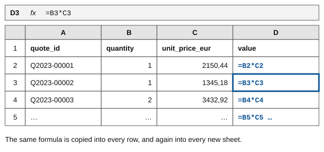
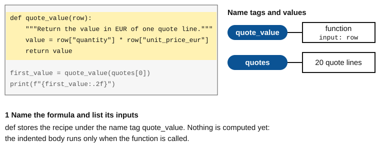
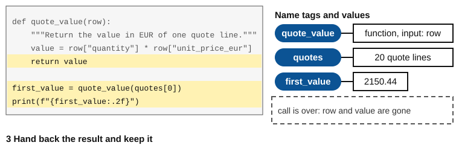

You will be able to:

- define a function with `def` and call it, and say in which order the lines run (G5, M9);
- tell parameters from arguments and use default values and keyword arguments (G5);
- hand a result back with `return` instead of `print` (G5, M8);
- refuse bad input with `raise ValueError` (X4).

## Warm-up {#warmup .step}

Four quick questions on decisions, lists and dictionaries. Answer from memory.

::: {.quiz #u7-warmup .warmup}

::: {.question tags="U3 G2"}
What is the value of `discount_label` after this code runs?

```python
pct = 12
if pct >= 10:
    discount_label = "high"
elif pct > 0:
    discount_label = "standard"
else:
    discount_label = "none"
```
- [ ] `"standard"`
- [x] `"high"`
- [ ] `"none"`
- [ ] `"high"` and then `"standard"`
:::

::: {.question tags="U5 G4"}
`quantities = [1, 1, 2, 2, 1, 2, 1, 10]`. What does `quantities[-1]` give?

- [ ] `1`
- [ ] `2`
- [x] `10`
- [ ] An error, because there is no position -1
:::

::: {.question tags="U6 G4" answer="0"}
`row = {"quote_id": "Q2023-00004", "quantity": 2}`. What does `row.get("discount_pct", 0)` give?
Type the value.
:::

::: {.question tags="U6 G4"}
`quotes` is a list of dicts, one per quote line. What does this code print?

```python
won = 0
for q in [{"status": "Won"}, {"status": "Lost"}, {"status": "Won"}]:
    if q["status"] == "Won":
        won += 1
print(won)
```
- [ ] `1`
- [x] `2`
- [ ] `3`
- [ ] `Won Won`
:::

:::

## Why {#why .step}

As a presales analyst at Fluvia you compute the value of a quote line many times a day: for one
customer, for one sales rep, for this month's report. In a spreadsheet you type `=B2*C2` and copy it
down, then copy it again into every new sheet. If the rule changes, you hunt for every copy. A
**function** is that formula written once, with a name, clear inputs and one result. You call it
wherever you need it, and you change it in one place.

{fig-alt="Spreadsheet with columns quote_id, quantity, unit_price_eur and value. The value cells hold =B2*C2, =B3*C3, =B4*C4: the same formula copied into every row."}

## Worked example {#worked .step}

The hidden setup gives you `quotes`, the first 20 rows of the quote book as a list of dicts, and
`products`, the product catalogue as a dict by `product_id`. The goal: one function that gives the
value in EUR of any quote line. Build it in four subgoals:

1. **Name the formula and list its inputs.** `def quote_value(row):` names the function. `row` is a
   *parameter*: the name the input gets inside the function.
2. **Describe it in one line.** The docstring under `def` says what comes back.
3. **Compute and hand back the result.** The indented body computes; `return` hands the value back.
4. **Call it.** `quote_value(quotes[0])` runs the body with `quotes[0]` as the *argument*, the actual
   value given in the call.

Step through the animation. Watch the name tags.

::: {.anim #u7-anim}

::: {.frame title="1 Name the formula and list its inputs"}
{fig-alt="Step 1: def stores the function under the name tag quote_value; nothing is computed."}

Python reads the `def` block and stores the recipe under the name tag `quote_value`. Nothing is
computed yet. The indented body runs only when someone calls the function.
:::

::: {.frame title="2 Call it and compute"}
![Step 2: inside the call, row is a second name tag on quotes[0] and value is tagged on 2150.44.](anim/frame2.svg)

The line `first_value = quote_value(quotes[0])` calls the function. Python jumps into the body. The
parameter `row` becomes a second name tag on the argument `quotes[0]`. The body computes
1 x 2150.44 and puts the name tag `value` on the result.
:::

::: {.frame title="3 Hand back the result"}
{fig-alt="Step 3: return hands 2150.44 back; first_value is tagged on it; row and value are gone."}

`return value` hands 2150.44 back to the line that called. There `first_value` gets tagged on it.
The call is over, so the names `row` and `value` are gone. `print` shows `2150.44`.
:::

::: {.reveal}
```python
def quote_value(row):
    """Return the value in EUR of one quote line."""
    value = row["quantity"] * row["unit_price_eur"]
    return value


first_value = quote_value(quotes[0])
print(f"{first_value:.2f}")
```
:::

:::

Now type the example yourself into the cell below and press **Run**. Typing it, not pasting it,
is what makes it stick. Indent the body with four spaces.

```{pyodide}
#| exercise: retype
# Type the worked example here.
```

```{pyodide}
#| exercise: retype
#| setup: true

```

```{pyodide}
#| exercise: retype
#| check: true

```

::: {.hint exercise="retype"}
Start with the `def` line: the name of the function, its input in brackets, and a colon.
:::

::: {.hint exercise="retype"}
Every line of the body is indented by four spaces. The last body line hands the value back.
:::

::: {.hint exercise="retype"}
After the function, call it on `quotes[0]` and store the result in `first_value`.
:::

::: {.solution exercise="retype"}
```python
def quote_value(row):
    """Return the value in EUR of one quote line."""
    value = row["quantity"] * row["unit_price_eur"]
    return value


first_value = quote_value(quotes[0])
print(f"{first_value:.2f}")
```
:::

**Names inside stay inside.** `row` and `value` are *local* names: they exist only while the call
runs. Outside the function, `print(value)` fails with `NameError`. That is a feature: the function
cannot trip over your other names, and you get its result the clean way, through `return`.

## Predict and run {#predict .step}

This variant prints the value inside the function instead of returning it. Lock in what the two
`print` lines will show, then run it.

::: {.predict #u7-predict}
```{pyodide}
def show_value(row):
    print(row["quantity"] * row["unit_price_eur"])


row_4 = {"quote_id": "Q2023-00004", "quantity": 2, "unit_price_eur": 9350.55}
result = show_value(row_4)
print(result)
```

::: {.explain}
The first line is `18701.1`: `print` inside the function shows the value. The second line is
`None`. `print` only shows a value on the screen; it does not hand anything back. A function without
`return` gives back `None`, Python's value for "nothing". If you want to keep a result, `return` it.
:::
:::

## Parsons problem {#parsons .step}

Put the lines in order and indent them to build `won_value(rows)`: the total value of the won
quote lines. It uses `quote_value` from the worked example. Two lines are not needed.

::: {.parsons #u7-parsons}
```python
def won_value(rows):
    total = 0
    for row in rows:
        if row["status"] == "Won":
            total += quote_value(row)
    return total
```
```{.python .distractor}
def won_value():
```
```{.python .distractor}
    print(total)
```
:::

## Modify {#modify .step}

### First, fix an error

You get a line that shows the product name of a quote. Run the cell as it is and read the error
message. Then fix the code so that it runs and `first_name` holds the product name of
`quotes[0]`.

```{pyodide}
#| exercise: fix_order
first_name = product_name(quotes[0])
print(first_name)


def product_name(row):
    """Return the product name of one quote line."""
    return products[row["product_id"]]["product_name"]
```

```{pyodide}
#| exercise: fix_order
#| setup: true

```

```{pyodide}
#| exercise: fix_order
#| check: true

```

::: {.hint exercise="fix_order"}
Read the error message: which name does Python not know yet?
:::

::: {.hint exercise="fix_order"}
Python runs a cell from top to bottom. A name exists only after the `def` line has run.
:::

::: {.hint exercise="fix_order"}
Move the two calling lines below the `def` block. The function itself is fine.
:::

::: {.solution exercise="fix_order"}
```python
def product_name(row):
    """Return the product name of one quote line."""
    return products[row["product_id"]]["product_name"]


first_name = product_name(quotes[0])
print(first_name)
```
:::

::: {.error-explain exception="NameError" match="product_name"}
Python runs a cell from top to bottom. `product_name` only exists after its `def` block has run,
and in this cell the call comes first.
:::

### Then, add an input with a default

Your manager asks: "What is a quote line worth if we grant an extra discount?" Give `quote_value` a
second parameter, `extra_discount_pct`, with a **default value** of 0, so old calls with only a row
still work. Then store in `offer` the value of `quotes[2]` with 5 percent extra discount.

Two new forms help here:

- `def quote_value(row, extra_discount_pct=0):` sets a default: if the call leaves the argument out,
  it is 0.
- `quote_value(quotes[2], extra_discount_pct=5)` passes a **keyword argument**: the name says which
  parameter gets the 5, so the call reads like a sentence.

```{pyodide}
#| exercise: extra_discount
def quote_value(row):
    """Return the value in EUR of one quote line."""
    value = row["quantity"] * row["unit_price_eur"]
    return value


offer = quote_value(quotes[2])
print(f"{offer:.2f}")
```

```{pyodide}
#| exercise: extra_discount
#| setup: true

```

```{pyodide}
#| exercise: extra_discount
#| check: true

```

::: {.hint exercise="extra_discount"}
First add the new input to the `def` line, with its default value.
:::

::: {.hint exercise="extra_discount"}
Then reduce the value in the body. An extra discount of 5 percent leaves `1 - 5 / 100` of the value.
:::

::: {.hint exercise="extra_discount"}
Finally change the call: pass `extra_discount_pct=5` after `quotes[2]`.
:::

::: {.solution exercise="extra_discount"}
```python
def quote_value(row, extra_discount_pct=0):
    """Return the value in EUR of one quote line after an optional extra discount."""
    value = row["quantity"] * row["unit_price_eur"] * (1 - extra_discount_pct / 100)
    return value


offer = quote_value(quotes[2], extra_discount_pct=5)
print(f"{offer:.2f}")
```
:::

::: {.callout-note}
## Recognise only: `*args`

In other people's code you will meet `def total(*values):`. The star means "any number of
arguments", collected into a tuple, the way `print` accepts as many values as you give it. You do
not need to write it in this course.
:::

## Make {#make .step}

Sales management sorts discounts into three classes: **none** (0 %), **standard** (above 0 and below
10 %) and **high** (10 % or more). A negative discount is a data error: the function should refuse
it instead of returning a wrong class. You refuse bad input with `raise`:

```python
raise ValueError("A discount cannot be negative.")
```

`raise` stops the function at once and shows your message as a `ValueError`. Nothing is returned.

Your task: finish `discount_class(pct)`, then count how many of the first 20 rows of the quote book
fall into each class. Store the counts in the dict `counts`.

```{pyodide}
#| exercise: discount_classes
def discount_class(pct):
    """Return the discount class "none", "standard" or "high" of a discount in percent."""
    if pct < 0:
        ______
    ______


counts = {"none": 0, "standard": 0, "high": 0}
for row in quotes:
    ______
print(counts)
```

```{pyodide}
#| exercise: discount_classes
#| setup: true

```

```{pyodide}
#| exercise: discount_classes
#| check: true

```

::: {.hint exercise="discount_classes"}
Refuse first: when `pct` is below 0, raise a `ValueError` with a message.
:::

::: {.hint exercise="discount_classes"}
Then sort into classes with `if`, `elif` and `else`, and `return` the class name in each branch.
:::

::: {.hint exercise="discount_classes"}
In the loop, look up the class of `row["discount_pct"]` and add 1 to that entry of `counts`.
:::

::: {.solution exercise="discount_classes"}
```python
def discount_class(pct):
    """Return the discount class "none", "standard" or "high" of a discount in percent."""
    if pct < 0:
        raise ValueError("A discount cannot be negative.")
    if pct == 0:
        return "none"
    elif pct < 10:
        return "standard"
    else:
        return "high"


counts = {"none": 0, "standard": 0, "high": 0}
for row in quotes:
    counts[discount_class(row["discount_pct"])] += 1
print(counts)
```
:::

## Exit check {#exit .step}

::: {.quiz #u7-exit .exit}

::: {.question tags="M9"}
A colleague runs this cell. What happens?

```python
def quote_value(row):
    print("computing")
    value = row["quantity"] * row["unit_price_eur"]
    return value


print(value)
```
- [ ] It prints `computing`, then the value.
- [ ] It prints `computing`, then fails with `NameError`.
- [x] It fails with `NameError` and prints nothing else.
- [ ] It prints `None`.
:::

:::
